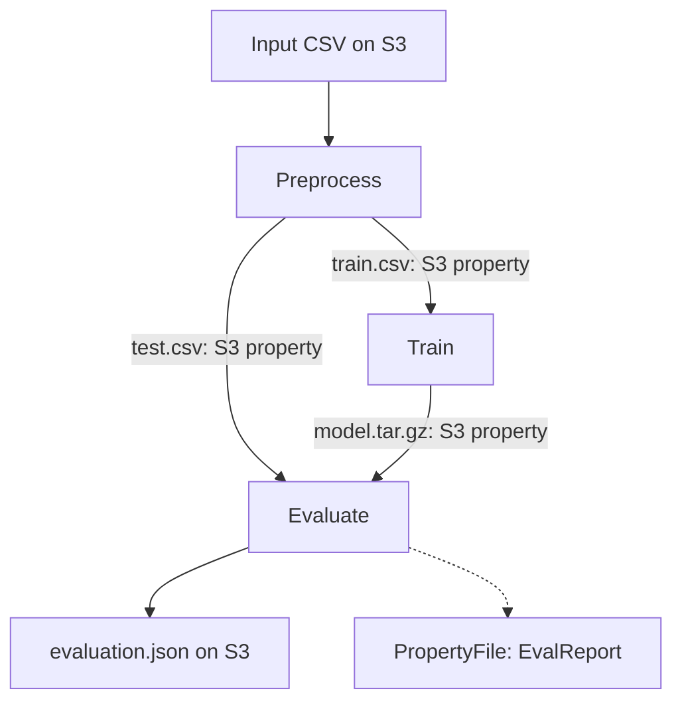
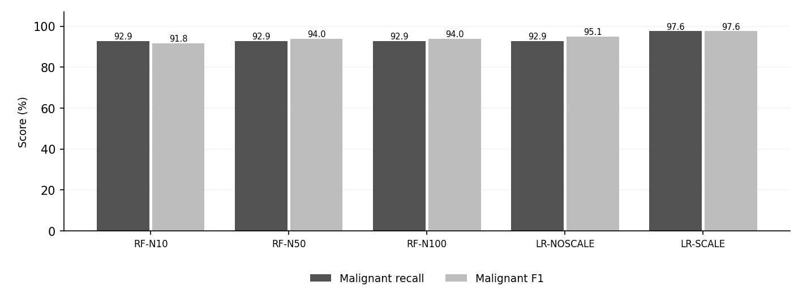

# Breast Cancer Classification — SageMaker Pipelines

Breast Cancer Wisconsin (Diagnostic) 데이터셋으로 **데이터 전처리 → 모델 학습 → 모델 평가**를 자동화한 SageMaker Pipelines 실험 프로젝트입니다. Random Forest의 트리 개수, 모델 종류, 특성 스케일링 여부를 변경한 **5회 실행**을 완료하고, S3에 기록한 평가 결과를 비교했습니다.

> **범위:** SageMaker 관리형 Processing/Training, S3 아티팩트, 평가 지표 기록, 반복 실행 및 결과 비교. 실제 추론 Endpoint 배포는 수행하지 않았습니다. 상용 운영 시스템이 아닌 재현 가능한 실험 워크플로입니다.

## Pipeline architecture



- **Preprocess:** 80/20 stratified split; `stratify=y`, `random_state=42`
- **Train:** `ModelType` (`random_forest` / `logistic_regression`), `NEstimators`, `UseScaling` (`true` / `false`)
- **Evaluate:** Accuracy, Precision, Recall, F1 with **malignant = class 0 as the positive class**; S3 `evaluation.json` registered as `PropertyFile`

## Experiment results

같은 테스트 분할 **114건**에 대한 실제 SageMaker 평가 결과입니다. 악성 종양은 **class 0**이며, Precision/Recall/F1은 `pos_label=0`으로 계산했습니다.

| Configuration | Accuracy | Precision (malignant) | Recall (malignant) | F1 (malignant) | Missed malignant |
| --- | ---: | ---: | ---: | ---: | ---: |
| Random Forest · 10 trees | 93.86% | 90.70% | 92.86% | 91.76% | 3 |
| Random Forest · 50 trees | 95.61% | 95.12% | 92.86% | 93.98% | 3 |
| Random Forest · 100 trees | 95.61% | 95.12% | 92.86% | 93.98% | 3 |
| Logistic Regression · scaling OFF | 96.49% | 97.50% | 92.86% | 95.12% | 3 |
| **Logistic Regression · scaling ON** | **98.25%** | **97.62%** | **97.62%** | **97.62%** | **1** |



### Observations

- RF는 10개에서 50개 트리로 늘렸을 때 성능이 높아졌지만, 50개와 100개의 테스트 결과는 같았습니다.
- Logistic Regression에서는 `StandardScaler`를 추가했을 때 악성 Recall이 **92.86% → 97.62%**로 개선되고, 악성 미탐지가 **3건 → 1건**으로 줄었습니다.
- 이 테스트 분할에서 LR + StandardScaler가 가장 높은 성능을 기록했습니다. **단일 114건 테스트 분할의 관측치**이며 일반화 성능이나 의료적 사용 적합성을 증명하지는 않습니다.

자세한 해석은 [실험 결과 분석](docs/02-experiments.md)을 참고하세요.

## Project structure

```text
breast-cancer-pipeline/
├── README.md
├── requirements.txt
├── requirements-sagemaker.txt
├── .env.example
├── src/
│   ├── preprocess.py
│   ├── train.py                 # Initial Random Forest baseline
│   ├── train_multi.py           # Random Forest / Logistic Regression + scaler
│   ├── evaluate.py
│   └── sagemaker_pipeline.py    # SDK 3.x pipeline definition
├── scripts/
│   ├── prepare_dataset.py
│   ├── upsert_pipeline.py
│   ├── launch_experiment.py
│   ├── inspect_results.py
│   └── reproduce_local.py
├── notebooks/
│   ├── 00_environment_check.ipynb
│   ├── 01_pipeline_build.ipynb  # Clean reuse notebook
│   └── archive/                 # Redacted original cell source, read-only
├── data/breast_cancer.csv
├── results/                      # Original evaluation JSONs and comparison CSVs
├── tests/test_local_pipeline.py
└── docs/                         # Architecture, methods, findings, operations
```

## Quick start (local, no AWS jobs)

Python 환경에서 프로젝트 루트 기준으로 실행합니다.

```bash
python -m pip install -r requirements.txt
python scripts/prepare_dataset.py
python -m unittest discover -s tests -v
python scripts/inspect_results.py
python scripts/reproduce_local.py
```

## SageMaker pipeline definition (AWS required)

SDK 3.x 환경에 다음을 추가로 설치합니다.

```bash
python -m pip install -r requirements-sagemaker.txt
export AWS_REGION=ap-northeast-2
export BC_S3_BUCKET=<your-s3-bucket>
export BC_SAGEMAKER_ROLE_ARN=<your-sagemaker-execution-role-arn>
python scripts/prepare_dataset.py --upload
python scripts/upsert_pipeline.py            # Definition validation only
python scripts/upsert_pipeline.py --apply    # AWS registration; no job started
```

실제 학습은 **명시적으로** `scripts/launch_experiment.py --execute`를 지정할 때만 시작됩니다. 실행에 따른 AWS 비용이 발생합니다. 실행 예시 및 정리 방법은 [재현 절차](docs/03-reproducibility.md)와 [AWS 운영 메모](docs/04-aws-operations.md)에 정리했습니다.

## Environment and provenance

- AWS Region: Seoul (`ap-northeast-2`)
- SageMaker SDK: `3.26.0` (`sagemaker[train,mlops]`)
- SageMaker scikit-learn image: `1.4-2-cpu-py3`
- Dataset: Wisconsin Diagnostic Breast Cancer, 569 rows / 30 input features / target classes 0=malignant and 1=benign
- Split: 455 train / 114 test, stratified, random seed 42
- 실제 AWS에서 사용한 **4개 학습·전처리·평가 스크립트 및 원본 결과 JSON/CSV**는 개인 JupyterLab 백업과 대조한 뒤 그대로 반영했습니다.
- 공개 실행용 Notebook은 민감정보를 제거해 재구성한 버전입니다. 원본 Notebook의 **셀 소스**는 실행 출력과 개인 식별자를 제거한 **읽기 전용 아카이브**로 별도 수록했습니다.
- 실험 수치는 당시 실제 S3 `evaluation.json` 결과에서 확보한 값입니다. 상세한 파일 출처와 차이점은 [원본 백업 대조 기록](docs/07-original-source-reconciliation.md)에 정리했습니다.

관련 설계와 데이터 처리 조건은 [아키텍처](docs/01-architecture.md) 및 [재현성 검토](docs/03-reproducibility.md)에 정리했습니다.
