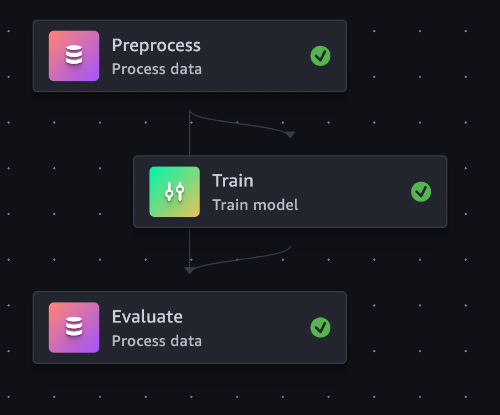
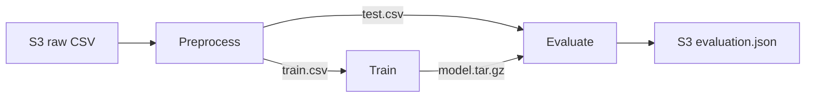

# Architecture and data flow

## Goal

Build a repeatable SageMaker Pipelines workflow for binary classification on the Wisconsin Diagnostic Breast Cancer dataset using managed Processing, Training and S3 artifacts.

## Dataset

- Source: scikit-learn `load_breast_cancer(as_frame=True)` (original data attributed to the UCI Wisconsin Diagnostic Breast Cancer dataset).
- 569 samples, 30 numerical features and `target`.
- Class 0 = malignant (positive class in evaluation), class 1 = benign.
- The input CSV is generated by `scripts/prepare_dataset.py`. Its local copy is included for convenient inspection.
- 80/20 stratified train/test split (`random_state=42`) yields training: 455 (170 malignant, 285 benign), test: 114 (42 malignant, 72 benign).

## DAG





| Component | Implementation | Input | Output |
| --- | --- | --- | --- |
| Preprocess | `src/preprocess.py` | Raw S3 CSV | S3 `train.csv`, `test.csv` |
| Train | `src/train_multi.py` | Preprocess `train` output | S3 `model.tar.gz` |
| Evaluate | `src/evaluate.py` | Preprocess `test` output; Train model artifact | S3 `evaluation.json` |

## Step properties

In `src/sagemaker_pipeline.py` the flow is connected with **SageMaker symbolic properties**, not hard-coded run-specific S3 paths:

```python
step_prep.properties.ProcessingOutputConfig.Outputs["train"].S3Output.S3Uri
step_prep.properties.ProcessingOutputConfig.Outputs["test"].S3Output.S3Uri
step_train.properties.ModelArtifacts.S3ModelArtifacts
```

Preprocessing and evaluation outputs include `ExecutionVariables.PIPELINE_EXECUTION_ID` in their S3 prefixes to separate executions.

## Pipeline parameters

| Name | Type | Usage |
| --- | --- | --- |
| `NEstimators` | `ParameterString` | Random Forest tree count: 10, 50, 100 |
| `ModelType` | `ParameterString` | `random_forest` or `logistic_regression` |
| `UseScaling` | `ParameterString` | `true` or `false`, enables `StandardScaler` inside the fitted model |

A Logistic Regression run can include `NEstimators` as a common Pipeline parameter, but Logistic Regression does not consume this setting.

## Platform-native evaluation

`src/evaluate.py` writes `evaluation/evaluation.json` with `metrics`, `positive_class`, `test_samples` and `confusion_matrix`. The `Evaluate` ProcessingStep registers:

```python
PropertyFile(name="EvalReport", output_name="evaluation", path="evaluation.json")
```

During definition validation, the SageMaker JSON includes `PropertyFileName: EvalReport`, `OutputName: evaluation`, `FilePath: evaluation.json`.

### Label convention

`recall_score(y_test, y_pred, pos_label=0)`, `precision_score(..., pos_label=0)`, and `f1_score(..., pos_label=0)` measure *malignant* detection. With confusion-matrix labels `[0,1]`, malignant false negatives appear at position `[0][1]`.
