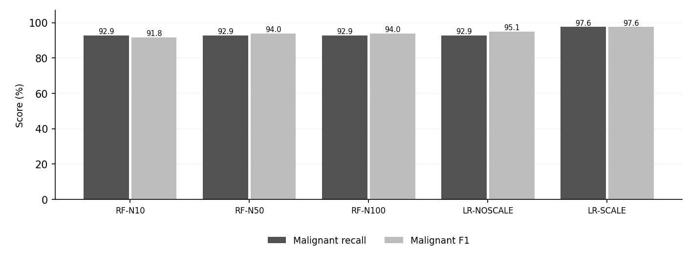

# Experimental results and interpretation

Five AWS Pipeline executions completed successfully with a fixed stratified train/test split. The numeric records here are from the stored SageMaker `evaluation.json` outputs, not estimated from local tests.

## Evaluation protocol

- Test size: **114** (42 malignant, 72 benign)
- **Positive class = 0 (malignant)** for Precision, Recall and F1
- Fixed data split and estimator random seed: **42**
- One parameter axis changed at a time for the three comparisons below
- The evaluation step reads the trained model artifact and held-out `test.csv`

## Measured results

| Experiment | Model | Scaling | Trees | Accuracy | Precision (0) | Recall (0) | F1 (0) | Malignant FN |
| --- | --- | :---: | ---: | ---: | ---: | ---: | ---: | ---: |
| RF-N10 | Random Forest | OFF | 10 | 0.9386 | 0.9070 | 0.9286 | 0.9176 | 3 |
| RF-N50 | Random Forest | OFF | 50 | 0.9561 | 0.9512 | 0.9286 | 0.9398 | 3 |
| RF-N100 | Random Forest | OFF | 100 | 0.9561 | 0.9512 | 0.9286 | 0.9398 | 3 |
| LR-NOSCALE | Logistic Regression | OFF | — | 0.9649 | 0.9750 | 0.9286 | 0.9512 | 3 |
| **LR-SCALE** | **Logistic Regression** | **ON** | — | **0.9825** | **0.9762** | **0.9762** | **0.9762** | **1** |

## Confusion matrices

Matrix axes: **actual class** (rows 0, 1) by **predicted class** (columns 0, 1).

| Experiment | Confusion matrix | Interpretation |
| --- | --- | --- |
| RF-N10 | `[[39, 3], [4, 68]]` | 3 malignant false negatives, 4 benign false positives |
| RF-N50 | `[[39, 3], [2, 70]]` | 3 malignant false negatives, 2 benign false positives |
| RF-N100 | `[[39, 3], [2, 70]]` | Same predictions counts as RF-N50 |
| LR-NOSCALE | `[[39, 3], [1, 71]]` | 3 malignant false negatives, 1 benign false positive |
| LR-SCALE | `[[41, 1], [1, 71]]` | 1 malignant false negative, 1 benign false positive |

## Comparison A — Random Forest tree count

Increasing trees from 10 to 50 improves Accuracy by about **1.75 percentage points** and malignant F1 by about **2.21 percentage points**. Malignant Recall does not change: all three RF configurations miss 3 of 42 malignant cases. Trees 50 and 100 return the same four metrics and confusion matrix on this holdout set. That does not prove equal behavior on all datasets; there is no measured inference/compute benchmark here.

## Comparison B — Model family

Compare RF-N50 with LR-NOSCALE (both scaling OFF) to isolate the model-family difference within the same data split: Logistic Regression has higher Accuracy (0.9649 vs 0.9561) and malignant F1 (0.9512 vs 0.9398). Both have malignant Recall 0.9286 and miss 3 malignant cases.

## Comparison C — Scaling ON vs OFF

With Logistic Regression unchanged apart from `StandardScaler`, malignant Recall improves from **0.9286 to 0.9762 (+4.76 percentage points)**. The malignant false-negative count falls **3 → 1** and Accuracy improves **0.9649 → 0.9825**.

The scaler is a step in the fitted sklearn Pipeline, so it is fitted on training data and reused for test data without fitting on holdout examples.

## Final experimental choice

**LR-SCALE** is the strongest candidate *on this holdout split*: highest Accuracy, malignant Precision, Recall and F1, and fewest missed malignant cases. In a screening-oriented setting, reducing malignant false negatives is particularly relevant; Accuracy alone would be insufficient to evaluate that risk.

## Limitations

- One stratified train/test split (114 holdout samples); no cross-validation or independent external cohort.
- No probability threshold tuning, calibration, ROC-AUC or confidence intervals were measured.
- Identical seeds help reproducibility, but differences in container/library versions and execution environments can alter exact results.
- This dataset experiment does not establish medical-device readiness or suitability for clinical diagnosis.
